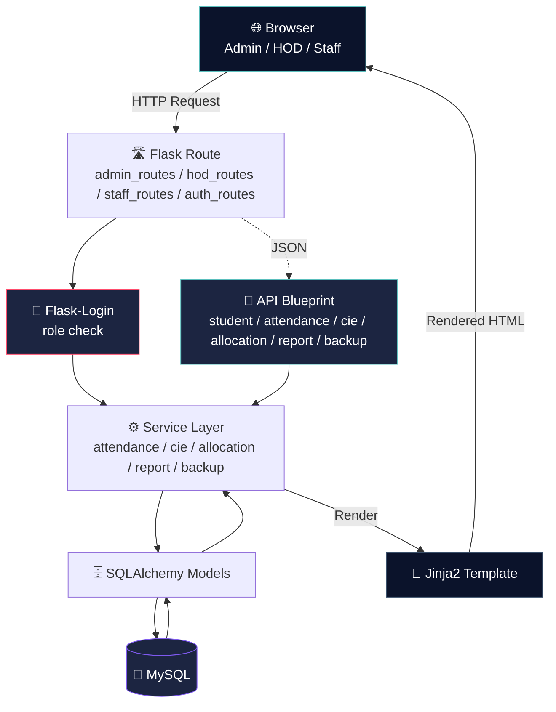

<div align="center">


<br/><br/>

<p>
  
  
  
  
  
</p>

<p>
  
  
  
</p>

<h3>🎓 A role-based college management system for attendance, internal assessments (CIE), staff allocation, and reporting</h3>

</div>

---

## 📖 Overview

The **College Management System (CMS)** is a Flask web application that automates day-to-day academic administration: attendance tracking, **CIE (Continuous Internal Evaluation)** marks, staff-to-subject allocation, student records, and database backup/restore — all behind role-based authentication for **Admin**, **HOD**, and **Staff** users.

<table align="center">
<tr>
<td align="center">🏗️<br/><b>Architecture</b><br/>Flask Blueprints (Route → Service → SQLAlchemy Model)</td>
<td align="center">🔐<br/><b>Auth</b><br/>Flask-Login, role-gated routes</td>
<td align="center">🗄️<br/><b>Data Layer</b><br/>SQLAlchemy + Flask-Migrate</td>
<td align="center">📄<br/><b>Reports</b><br/>PDF (reportlab/fpdf2) & Excel (pandas/openpyxl)</td>
</tr>
</table>

## ✨ Features

<table align="center" width="100%">
<tr>
<td width="25%" valign="top">

### 👤 Access Control
- Role-based login (Admin / HOD / Staff)
- Secure session auth (Flask-Login)
- User & role management

</td>
<td width="25%" valign="top">

### 📝 Attendance & CIE
- Attendance marking & tracking
- CIE paper & marks management
- CIE configuration per subject

</td>
<td width="25%" valign="top">

### 📚 Academics
- Student, batch, branch & class records
- Subject management
- Staff allocation to subjects/classes

</td>
<td width="25%" valign="top">

### 📊 Reports & Data
- PDF & Excel report generation
- Database backup & restore (.xlsx)
- Bulk student upload templates

</td>
</tr>
</table>

## 🛠️ Technology Stack

<div align="center">


</div>

| Layer | Technology |
|---|---|
| **Backend** | Python, Flask, Flask-SQLAlchemy, Flask-Migrate, Flask-Login |
| **Database** | MySQL (via PyMySQL) |
| **Reports** | reportlab, fpdf2, pandas, openpyxl |
| **Security** | cryptography, python-dotenv |
| **Frontend** | HTML5, CSS3, JavaScript (Jinja2 templates) |

## 🏗️ Architecture & Workflow



**Request flow:** page routes (`admin_routes`, `hod_routes`, `staff_routes`, `auth_routes`) render server-side templates, while a parallel set of API blueprints (`student_api`, `attendance_api`, `cie_api`, `allocation_api`, `report_api`, `backup_api`) handle data operations. Both paths go through the same service layer down to SQLAlchemy models backed by MySQL.

## 📂 Domain Model

Core models: `User`, `Role`, `Student`, `Batch`, `Branch`, `ClassModel`, `Subjects`, `StaffAllocation`, `Attendance`, `CieConfig`, `CieMarks`, `CiePapers`, `BackupLog`, `Setting`, `Control`, `Maintain`.

## 🚀 Installation

**1. Clone the repository**
```bash
git clone https://github.com/Nesara29/CMS.git
cd CMS
```

**2. Create a virtual environment & install dependencies**
```bash
python -m venv venv
venv\Scripts\activate      # Windows
source venv/bin/activate   # macOS/Linux
pip install -r requirements.txt
```

**3. Configure the database**

Set your MySQL connection string and secret keys in `config/config.py` or a `.env` file (loaded via `python-dotenv`).

**4. Run database migrations**
```bash
flask db upgrade
```

**5. Run the application**
```bash
python app.py
```

**6. Open your browser**
```
http://127.0.0.1:5000
```

## 📂 Project Structure

```
CMS/
├── app.py
├── wsgi.py
├── extensions.py
├── config/
│   └── config.py
├── models/                 → student, staff_allocation, attendance, cie_marks,
│                              cie_papers, cie_config, batch, branch, subjects,
│                              class_model, role, user, backup_log, setting, control
├── routes/                 → admin_routes, hod_routes, staff_routes, auth_routes
├── api/                    → student_api, attendance_api, cie_api,
│                              allocation_api, report_api, backup_api
├── services/                → attendance_service, cie_service, allocation_service,
│                              report_service, backup_service, auth_service
├── utils/                  → decorators, file_handler, pdf_generator,
│                              password_utils, seed_data
├── templates/               → admin.html, hod.html, staff.html, login.html,
│                              manage_users.html, report_pdf.html
├── migrations/              → Alembic migration scripts
├── backups/                 → generated .xlsx database backups
├── uploads/cie_papers/       → uploaded CIE paper files
├── logs/app.log
├── requirements.txt
└── README.md
```

## 🎯 Learning Outcomes

🐍 Python & Flask &nbsp;•&nbsp; 🗄️ SQLAlchemy ORM & Alembic migrations &nbsp;•&nbsp; 🔐 Flask-Login role-based access &nbsp;•&nbsp; 📄 PDF generation (reportlab/fpdf2) &nbsp;•&nbsp; 📊 Excel import/export (pandas/openpyxl) &nbsp;•&nbsp; 🐬 MySQL relational design &nbsp;•&nbsp; 🔌 Blueprint-based API design &nbsp;•&nbsp; 🔒 Data encryption with `cryptography`

## 📈 Future Enhancements

<table align="center">
<tr>
<td>🌐 Online Student Portal</td>
<td>👪 Parent Portal</td>
<td>💳 Fee Management System</td>
</tr>
<tr>
<td>🗓️ Timetable Management</td>
<td>📝 Examination Management</td>
<td>📧 Email & SMS Notifications</td>
</tr>
<tr>
<td>🔑 Finer-Grained Role Permissions</td>
<td>📱 Mobile Application Support</td>
<td>☁️ Cloud Deployment</td>
</tr>
</table>

## 🤝 Contributing

Contributions are welcome!

1. Fork the repository.
2. Create a new feature branch.
3. Commit your changes.
4. Push your branch.
5. Submit a Pull Request.


## 🔗 Project Links

<div align="center">

<a href="https://github.com/Nesara29/CMS">
  
</a>
<a href="https://github.com/Nesara29/CMS/issues">
  
</a>
<a href="https://github.com/Nesara29/CMS/fork">
  
</a>

</div>

## 📄 License

This project is licensed for **educational and learning purposes**. You are free to use and modify it for academic or personal projects.

## ⭐ Support

If you found this project useful, please give it a **⭐ Star** on GitHub.


</div>
<!DOCTYPE html>
<html lang="en">
<head>
<meta charset="utf-8">
<meta name="viewport" content="width=device-width, initial-scale=1, viewport-fit=cover">
<title>College Management System · 3D</title>
<style>
:root{--bg:#0b132b;--panel:rgba(28,37,65,.88);--fg:#F1F5F9;--mut:#9aa7c0;--ac:#5BC0BE;box-sizing:border-box;padding-top:env(safe-area-inset-top,0px);padding-bottom:env(safe-area-inset-bottom,0px)}
html,body{height:100%;margin:0}
body{background:var(--bg);color:var(--fg);font-family:system-ui,-apple-system,"Segoe UI",Roboto,sans-serif;overflow:hidden}
canvas{display:block;position:fixed;inset:0;touch-action:none}
header{position:fixed;top:0;left:0;right:0;z-index:5;padding:calc(env(safe-area-inset-top,0px) + 20px) 22px 14px;pointer-events:none;background:linear-gradient(var(--bg),transparent)}
h1{margin:0;padding:0;border:0;font-size:clamp(18px,3.2vw,30px);letter-spacing:.04em}
header p{margin:6px 0 0;color:var(--mut);font-size:13px}
#panel{position:fixed;right:18px;top:96px;width:min(340px,calc(100% - 36px));background:var(--panel);backdrop-filter:blur(8px);border:1px solid rgba(255,255,255,.12);border-radius:14px;padding:16px 18px;display:none}
#panel h2{margin:0 0 4px;font-size:17px}
#panel .tag{color:var(--ac);font-size:12px;font-weight:600;letter-spacing:.08em;text-transform:uppercase}
#panel p{margin:10px 0;font-size:14px;line-height:1.5}
#panel code{display:block;background:rgba(0,0,0,.35);padding:8px 10px;border-radius:8px;font-size:12px;overflow-x:auto;white-space:pre}
#panel button{position:absolute;top:8px;right:10px;background:none;border:0;color:var(--mut);font-size:20px;cursor:pointer}
#chips{position:fixed;left:0;right:0;bottom:env(safe-area-inset-bottom,0px);display:flex;gap:8px;overflow-x:auto;padding:12px 18px}
#chips button{flex:none;background:var(--panel);color:var(--fg);border:1px solid rgba(255,255,255,.14);border-radius:999px;padding:7px 14px;font-size:13px;cursor:pointer}
#chips button.on{background:var(--ac);border-color:var(--ac);color:#0b132b}
#hint{position:fixed;left:22px;bottom:70px;color:var(--mut);font-size:12px;pointer-events:none}
</style>
</head>
<body>
<header><h1>COLLEGE MANAGEMENT SYSTEM</h1><p>Flask · SQLAlchemy · MySQL · Role-Based Access — drag to orbit, click a node</p></header>
<div id="panel"><button id="x" aria-label="Close">×</button><div class="tag" id="pt"></div><h2 id="pn"></h2><p id="pd"></p><code id="pr"></code></div>
<div id="hint">Drag to rotate · Click a module</div>
<div id="chips"></div>
<script src="https://cdnjs.cloudflare.com/ajax/libs/three.js/r128/three.min.js"></script>
<script>
const C={access:0xFF4D6D,role:0x5BC0BE,acad:0xF0B429,data:0x7F5AF0,report:0x2CB67D};
const D=[
{id:'Auth',n:'Authentication & Roles',s:'Flask-Login · Role-gated routes',k:'access',d:'Secure session login. Every route is gated by role (Admin, HOD or Staff) using decorators.',r:'routes/auth_routes.py\nservices/auth_service.py\nutils/decorators.py\nmodels/user.py, role.py'},
{id:'Admin',n:'Admin Dashboard',s:'Role: Admin',k:'role',d:'User and role management, system settings, and database backup and restore.',r:'routes/admin_routes.py\ntemplates/admin.html\ntemplates/manage_users.html'},
{id:'HOD',n:'HOD Dashboard',s:'Role: HOD',k:'role',d:'HODs allocate subjects and classes to staff and review department reports.',r:'routes/hod_routes.py\ntemplates/hod.html'},
{id:'Staff',n:'Staff Dashboard',s:'Role: Staff',k:'role',d:'Staff mark attendance and manage CIE papers and marks for their allocated subjects.',r:'routes/staff_routes.py\ntemplates/staff.html'},
{id:'Attendance',n:'Attendance Tracking',s:'Service + API + Model',k:'acad',d:'Mark and track student attendance per subject and class.',r:'services/attendance_service.py\napi/attendance_api.py\nmodels/attendance.py'},
{id:'CIE',n:'CIE Management',s:'Continuous Internal Evaluation',k:'acad',d:'CIE configuration per subject, marks entry, and CIE paper uploads.',r:'services/cie_service.py\napi/cie_api.py\nmodels/cie_config.py, cie_marks.py, cie_papers.py\nuploads/cie_papers/'},
{id:'Allocation',n:'Staff Allocation',s:'Staff ↔ Subject ↔ Class',k:'acad',d:'Allocates staff to subjects and classes.',r:'services/allocation_service.py\napi/allocation_api.py\nmodels/staff_allocation.py'},
{id:'Students',n:'Academic Records',s:'Students · Batches · Branches',k:'acad',d:'Student, batch, branch, class and subject records, with bulk student upload templates.',r:'api/student_api.py\nmodels/student.py, batch.py, branch.py,\n  class_model.py, subjects.py'},
{id:'Reports',n:'PDF & Excel Reports',s:'reportlab · fpdf2 · pandas · openpyxl',k:'report',d:'Generates PDF and Excel reports from attendance and CIE data.',r:'services/report_service.py\napi/report_api.py\nutils/pdf_generator.py'},
{id:'Backup',n:'Backup & Restore',s:'.xlsx database backups',k:'report',d:'Exports the database to .xlsx backups, restores from them, and logs each backup.',r:'services/backup_service.py\napi/backup_api.py\nmodels/backup_log.py\nbackups/'},
{id:'Database',n:'Data Layer',s:'SQLAlchemy · Flask-Migrate · MySQL',k:'data',d:'All paths go through the service layer to SQLAlchemy models backed by MySQL, with Alembic migrations.',r:'flask db upgrade\nmodels/\nmigrations/'}
];
const R=new THREE.WebGLRenderer({antialias:true,alpha:true});
R.setPixelRatio(Math.min(devicePixelRatio,2));R.setSize(innerWidth,innerHeight);document.body.prepend(R.domElement);
const S=new THREE.Scene();S.fog=new THREE.FogExp2(0x0b132b,.035);
const cam=new THREE.PerspectiveCamera(55,innerWidth/innerHeight,.1,100);cam.position.set(0,2.5,14);
S.add(new THREE.AmbientLight(0xffffff,.55));
const pl=new THREE.PointLight(0xffffff,1.3,60);pl.position.set(6,8,8);S.add(pl);
const knot=new THREE.Mesh(new THREE.TorusKnotGeometry(1.6,.4,120,16),new THREE.MeshBasicMaterial({color:0x5BC0BE,wireframe:true,transparent:true,opacity:.45}));
S.add(knot);
const sp=new Float32Array(1500);for(let i=0;i<1500;i++)sp[i]=(Math.random()-.5)*60;
const sg=new THREE.BufferGeometry();sg.setAttribute('position',new THREE.BufferAttribute(sp,3));
const stars=new THREE.Points(sg,new THREE.PointsMaterial({color:0xF1F5F9,size:.06,transparent:true,opacity:.7}));S.add(stars);
const G=new THREE.Group();S.add(G);
const nodes=[];
function label(t){const c=document.createElement('canvas');c.width=256;c.height=64;const x=c.getContext('2d');x.font='600 32px system-ui,sans-serif';x.fillStyle='#F1F5F9';x.textAlign='center';x.textBaseline='middle';x.fillText(t,128,34);
const sp=new THREE.Sprite(new THREE.SpriteMaterial({map:new THREE.CanvasTexture(c),transparent:true}));sp.scale.set(2.4,.6,1);return sp}
D.forEach((e,i)=>{
 const a=i/D.length*Math.PI*2,r=6.5;
 const m=new THREE.Mesh(new THREE.IcosahedronGeometry(.7,1),new THREE.MeshStandardMaterial({color:C[e.k],roughness:.35,metalness:.3,emissive:C[e.k],emissiveIntensity:.18}));
 m.position.set(Math.cos(a)*r,Math.sin(i*1.1)*1.3,Math.sin(a)*r);
 const l=label(e.id);l.position.y=1.3;m.add(l);
 m.add(new THREE.Mesh(new THREE.IcosahedronGeometry(.95,1),new THREE.MeshBasicMaterial({color:C[e.k],wireframe:true,transparent:true,opacity:.25})));
 m.userData={i,base:m.position.y,s:1};G.add(m);nodes.push(m);
});
const chips=document.getElementById('chips'),panel=document.getElementById('panel');
let sel=-1;
D.forEach((e,i)=>{const b=document.createElement('button');b.textContent=e.id;b.onclick=()=>pick(i);chips.appendChild(b)});
document.getElementById('x').onclick=()=>pick(-1);
function pick(i){
 sel=i;[...chips.children].forEach((b,j)=>b.classList.toggle('on',j===i));
 if(i<0){panel.style.display='none';return}
 const e=D[i];pt.textContent=e.s;pn.textContent=e.n;pd.textContent=e.d;pr.textContent=e.r;panel.style.display='block';
 const m=nodes[i];tgt=-Math.atan2(m.position.z,m.position.x)+Math.PI/2;
 let d=tgt-G.rotation.y;d=Math.atan2(Math.sin(d),Math.cos(d));tgt=G.rotation.y+d;focus=true;
}
let drag=false,moved=0,lx=0,vel=0,tgt=0,focus=false,mx=0,my=0;
const ray=new THREE.Raycaster(),ptr=new THREE.Vector2();
R.domElement.addEventListener('pointerdown',e=>{drag=true;moved=0;lx=e.clientX;focus=false});
addEventListener('pointerup',e=>{
 if(drag&&moved<5){
  ptr.set(e.clientX/innerWidth*2-1,-(e.clientY/innerHeight)*2+1);ray.setFromCamera(ptr,cam);
  const h=ray.intersectObjects(nodes,false)[0];pick(h?h.object.userData.i:-1);
 }drag=false});
addEventListener('pointermove',e=>{
 mx=e.clientX/innerWidth-.5;my=e.clientY/innerHeight-.5;
 if(drag){const dx=e.clientX-lx;lx=e.clientX;moved+=Math.abs(dx);vel=dx*.006;G.rotation.y+=vel}
});
addEventListener('resize',()=>{cam.aspect=innerWidth/innerHeight;cam.updateProjectionMatrix();R.setSize(innerWidth,innerHeight)});
const clk=new THREE.Clock();
(function loop(){
 requestAnimationFrame(loop);const t=clk.getElapsedTime();
 if(!drag){
  if(focus)G.rotation.y+=(tgt-G.rotation.y)*.06;
  else{vel*=.95;G.rotation.y+=vel+(sel<0?.003:0)}
 }
 knot.rotation.x=t*.25;knot.rotation.y=t*.35;stars.rotation.y=t*.01;
 nodes.forEach(m=>{const u=m.userData;m.rotation.y=t*.6+u.i;m.position.y=u.base+Math.sin(t*1.2+u.i)*.15;
  const ts=u.i===sel?1.5:1;u.s+=(ts-u.s)*.1;m.scale.setScalar(u.s)});
 cam.position.x+=(mx*3-cam.position.x)*.04;cam.position.y+=(2.5-my*2-cam.position.y)*.04;cam.lookAt(0,0,0);
 R.render(S,cam);
})();
</script>
</body>
</html>
